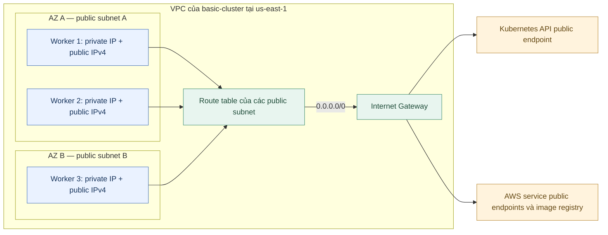

# Thiết kế VPC public subnet để chạy nguyên cụm của runbook bài 16

> **Phương án được chọn:** dùng hạ tầng do runbook chung dựng cho `basic-cluster`: toàn bộ worker node ở public subnet, có public IPv4, ra ngoài qua Internet Gateway, **không có NAT Gateway**. Trên hạ tầng này triển khai nguyên các bước của runbook MySQL Operator bài 16, không đổi chart, số Pod, cách cấp EBS hay cách backup/restore.
>
> Đây là bản thiết kế mới, độc lập với [bản private subnet + NAT](thiet-ke-vpc-eks-mysql-ebs.md). Bản cũ được giữ nguyên. Đối chiếu cấu hình và tài liệu ngày **17/11/2026**; không tạo lại cluster và không chạy kiểm thử AWS trong lần viết tài liệu này.

## Mục lục

- [1. Các quyết định thiết kế](#1-các-quyết-định-thiết-kế)
- [2. VPC, AZ và subnet](#2-vpc-az-và-subnet)
- [3. Route table và public IP](#3-route-table-và-public-ip)
- [4. Kubernetes API server: giữ public endpoint như runbook](#4-kubernetes-api-server-giữ-public-endpoint-như-runbook)
- [5. Security group và phạm vi truy cập MySQL](#5-security-group-và-phạm-vi-truy-cập-mysql)
- [6. Đặt nguyên các thành phần bài 16 lên hạ tầng này](#6-đặt-nguyên-các-thành-phần-bài-16-lên-hạ-tầng-này)
- [7. Đường đi tạo EBS, backup và restore](#7-đường-đi-tạo-ebs-backup-và-restore)
- [8. Ràng buộc AZ khi node hoặc Pod bị mất](#8-ràng-buộc-az-khi-node-hoặc-pod-bị-mất)
- [9. Điều kiện nghiệm thu thiết kế](#9-điều-kiện-nghiệm-thu-thiết-kế)
- [10. Cấu hình gốc và nguồn đối chiếu](#10-cấu-hình-gốc-và-nguồn-đối-chiếu)

## 1. Các quyết định thiết kế

| Hạng mục | Phương án dùng trong file này |
|---|---|
| Cluster | `basic-cluster` |
| Region | `us-east-1` |
| Kubernetes | `1.36`, theo cấu hình runbook chung tại thời điểm đối chiếu |
| Công cụ dựng hạ tầng | `eksctl`, theo runbook chung |
| VPC | VPC riêng do eksctl tạo; bật DNS support và DNS hostnames |
| Worker node | **Một managed node group `ng-1`, 3 máy `t3.large`, Amazon Linux 2023** |
| Vị trí worker node | **Public subnet; `privateNetworking: false` theo cấu hình mặc định đã được runbook kiểm bằng dry-run** |
| Public IPv4 | Có cho từng node, với public subnet bật tự cấp public IPv4 |
| NAT Gateway | **Tắt**, bằng `vpc.nat.gateway: Disable` |
| Đường ra ngoài của node | Public subnet → Internet Gateway → endpoint đích |
| Kubernetes API endpoint | Public access bật, private access tắt, theo mặc định khi runbook không ghi đè |
| Số AZ | Theo các AZ eksctl chọn khi dựng; mặc định ở `us-east-1` là hai AZ, không ép chuyển sang ba AZ |
| Security group | Giữ các security group và luật do EKS/eksctl tạo cho cluster/node group |
| MySQL | Chart `ps-operator` và `ps-db` **1.2.0**, namespace `ps`, release cụm `shop` |
| MySQL/HAProxy | 3 Pod MySQL và 3 Pod HAProxy theo mặc định chart |
| StorageClass | `ebs-csi-default-sc`, được đánh dấu mặc định |
| Ổ dữ liệu | Mỗi MySQL một EBS gp3 3 GiB; tổng cộng ba ổ dữ liệu |
| Backup | XtraBackup/xbcloud lên S3, dùng Secret `s3-backup-creds` như bài 16 |
| Load balancer cho database | Không tạo; giữ Service nội bộ của bài |

**Không tách node group theo từng AZ, không bắt MySQL phải rải ba AZ, không chuyển Kubernetes API sang private-only.** Các thay đổi đó thuộc phương án khác; chúng không phải điều kiện để nguyên lab bài 16 hoạt động.

## 2. VPC, AZ và subnet

### Bố trí được chọn

Để khớp runbook, eksctl tự tạo VPC và các subnet của cluster. Không tạo một VPC mới bằng tay rồi truyền vào runbook một bộ subnet khác.

Mặc định VPC của eksctl dùng CIDR `192.168.0.0/16`. Trong `us-east-1`, mặc định eksctl tạo public/private subnet ở hai AZ. AZ cụ thể và CIDR từng subnet phải lấy từ cấu hình sinh ra hoặc tài nguyên thực tế; tài liệu này không gán cứng chúng thành `us-east-1a`/`us-east-1b`.

| Khu vực | Bố trí |
|---|---|
| Public subnet A, AZ A | Một phần trong tổng ba worker node |
| Public subnet B, AZ B | Phần còn lại trong tổng ba worker node |
| Các private subnet do eksctl tạo kèm | Không dùng để đặt worker node của phương án này; không có NAT phục vụ chúng |
| Control plane | AWS vận hành; không phải ba EC2 worker. EKS đặt các ENI kết nối cluster vào các subnet được chọn của VPC |
| S3 | Dịch vụ AWS bên ngoài phạm vi subnet/VPC; bucket backup không được “đặt trong public subnet” |
| EBS | Tài nguyên lưu trữ thuộc AZ, attach vào EC2 cùng AZ; không phải một máy chủ đặt trong subnet |

EKS yêu cầu chọn subnet thuộc ít nhất hai AZ khi tạo cluster. Managed node group `ng-1` dùng các **public subnet**; tổng số node là ba, không phải ba node ở mỗi subnet. Một bố trí có thể là hai node ở AZ A và một node ở AZ B, nhưng đó không phải vị trí cố định được khai trong runbook.

Với Amazon VPC CNI mặc định, Pod có private IP từ mạng VPC. Đặt node trong public subnet **không cấp public IP riêng cho từng Pod**. Cần đủ IP còn trống trong subnet cho node, ENI và Pod; giữ cách chia subnet của eksctl phù hợp với quy mô lab.

### Sơ đồ hạ tầng

Sơ đồ mô tả một cách phân bố 2 + 1 node để đọc thiết kế, không phải kết quả phân bố đã đo trên tài khoản AWS.



Khối route table trong hình đại diện cho các route table được gắn với public subnet; không bắt buộc chỉ có đúng một object route table. Traffic nội bộ giữa node/Pod đi theo tuyến `local`, không phải đi qua Internet Gateway.

## 3. Route table và public IP

Mỗi public subnet đặt worker phải có route table với các tuyến sau:

| Đích | Target | Dùng cho |
|---|---|---|
| CIDR VPC, mặc định `192.168.0.0/16` | `local` | Node/Pod và các IP nội bộ khác trong cùng VPC |
| `0.0.0.0/0` | Internet Gateway của VPC | Kubernetes API public endpoint, AWS public endpoints và registry bên ngoài |

Không có tuyến `0.0.0.0/0 → NAT Gateway` trong đường ra của worker. Cấu hình `gateway: Disable` cũng không xoá Internet Gateway.

Để một node IPv4 ra ngoài bằng đường này, phải đồng thời có:

1. Node nằm trong public subnet có default route tới Internet Gateway.
2. EC2 có public IPv4; public subnet dùng cho managed node group bật `MapPublicIpOnLaunch`.
3. Security group/NACL cho phép traffic và gói trả về; giữ NACL mặc định của VPC theo cách dựng của lab.
4. DNS hoạt động để phân giải endpoint.

**Chỉ đặt EC2 vào một subnet có tên “public” chưa đủ nếu thiếu route tới IGW hoặc public IP.**

### Pod có private IP ra S3 bằng cách nào?

Với VPC CNI mặc định của Linux/IPv4, traffic từ Pod tới địa chỉ ngoài VPC được SNAT trên node sang private IP chính của node. Internet Gateway ánh xạ địa chỉ đó với public IPv4 của EC2 để giao tiếp ra ngoài.

Đường đi của một kết nối HTTPS từ Pod tới S3 gồm:

- Pod phát request bằng private IP của nó.
- VPC CNI/node thực hiện SNAT mặc định cho traffic ngoài VPC.
- Route public subnet chọn Internet Gateway.
- IGW xử lý ánh xạ public/private IPv4 của node; request tới S3 và response quay về kết nối đã có.

**Có SNAT trên node không đồng nghĩa có NAT Gateway.** Phương án này vẫn không tạo dịch vụ NAT Gateway và không cần phí NAT Gateway.

## 4. Kubernetes API server: giữ public endpoint như runbook

Runbook chung không khai báo `vpc.clusterEndpoints`. Theo mặc định EKS/eksctl, thiết kế này dùng:

| Trường | Giá trị hiệu lực |
|---|---|
| `endpointPublicAccess` | `true` |
| `endpointPrivateAccess` | `false` |

Node cần gọi Kubernetes API để đăng ký, báo trạng thái và theo dõi cấu hình/Pod được giao. Controller Percona cũng gọi Kubernetes API để đọc/ghi object; mạng nội bộ tới Service API được Kubernetes xử lý theo cấu hình cluster.

**Đối với đường node gọi địa chỉ API server public của cluster**, node đi qua Internet Gateway. Không được mô tả đường này là chỉ dùng route `local` trong VPC. AWS ghi rõ traffic từ VPC tới API public rời mạng VPC nhưng vẫn nằm trong mạng AWS.

Máy Windows/WSL của người vận hành cũng gọi public endpoint này qua HTTPS, nên tiếp tục dùng được các lệnh `kubectl`, theo dõi backup/restore và port-forward như runbook. Public endpoint vẫn yêu cầu xác thực và phân quyền IAM/Kubernetes; biết URL không có nghĩa được quản trị cluster.

Giữ các thiết lập truy cập API như runbook. Nếu tự thêm `publicAccessCIDRs` chỉ chứa IP laptop trong khi private endpoint vẫn tắt, node có thể bị chặn: với node public, public IPv4 của node cũng phải nằm trong phạm vi được phép. File này không thêm giới hạn CIDR khác với runbook.

Phân biệt ba loại endpoint:

| Đích | Vai trò | Cách tiếp cận trong thiết kế |
|---|---|---|
| Kubernetes API endpoint của `basic-cluster` | `kubectl`, kubelet, controller đọc/ghi tài nguyên Kubernetes | Giữ public access mặc định |
| AWS EKS service API | Các thao tác quản lý EKS như mô tả/tạo/cập nhật cluster | Gọi public endpoint của dịch vụ khi cần |
| AWS EKS Auth API | Pod Identity Agent lấy credentials cho Pod | Gọi public endpoint của EKS Auth qua đường mạng của node |

Không cần tạo VPC interface endpoint `eks` hay `eks-auth` để thay đường ra trong phương án public subnet có public IP này. Không dùng danh sách endpoint của phương án private không internet để làm điều kiện cho lab hiện tại.

## 5. Security group và phạm vi truy cập MySQL

Giữ security group do EKS/eksctl tạo theo runbook. EKS tự tạo cluster security group và liên kết nó với các ENI của cluster và managed node group theo cơ chế mặc định. Các group bổ sung do eksctl quản lý cũng được giữ nguyên.

Thiết kế sử dụng các đặc tính mặc định cần cho lab:

| Luồng | Yêu cầu |
|---|---|
| Giữa các thành viên có cluster security group | Cho phép traffic nội bộ theo luật self-reference của group |
| Node/Pod ra registry và AWS APIs | Cho phép outbound phù hợp, trong lab giữ outbound mặc định |
| Control plane tới kubelet | Duy trì đường và luật cho kubelet API, ví dụ các thao tác logs/exec/port-forward |
| Internet chủ động vào MySQL trên node | Không mở cổng 3306 từ `0.0.0.0/0` |
| Internet chủ động SSH vào node | Không bổ sung SSH access; runbook không cần SSH để vận hành bài 16 |

File này không thay bộ luật mặc định bằng một bộ “tối thiểu” mới, vì làm vậy có thể chặn các cổng nội bộ của Percona. Những luồng cần hoạt động gồm DNS, client MySQL, replication, HAProxy và HTTP nội bộ giữa Job backup với sidecar XtraBackup. Giữ luật nội bộ mặc định sẽ không làm hỏng các luồng đó.

### Public node không có nghĩa public MySQL

Các Service của cụm MySQL giữ loại nội bộ như chart/runbook:

- Ứng dụng gọi `shop-ps-db-haproxy` qua ClusterIP/DNS trong cluster.
- Service headless của MySQL phục vụ định danh/thông tin kết nối nội bộ giữa các thành viên.
- Không đổi Service thành `NodePort` hoặc `LoadBalancer`, không bật `hostPort`/`hostNetwork` để công khai MySQL.
- Không thêm load balancer public hay rule inbound 3306 cho node.

Với cấu hình đó, public IPv4 của EC2 không tự trở thành địa chỉ database public. Máy người học truy cập database theo client trong cluster hoặc port-forward của bài; không dùng `public-IP-node:3306`.

NetworkPolicy hoặc security group riêng cho Pod không phải điều kiện bổ sung của runbook này. Nếu triển khai chúng về sau, phải cho phép đủ traffic nội bộ và backup/restore, không chỉ client port 3306.

## 6. Đặt nguyên các thành phần bài 16 lên hạ tầng này

### Các workload đặt trên worker public

| Thành phần | Cách đặt |
|---|---|
| Pod operator `ps-operator` | Do chart operator quản lý, scheduler đặt lên một node phù hợp |
| `shop-ps-db-mysql-0/1/2` | Ba Pod thuộc StatefulSet MySQL, trên ba node khác nhau theo affinity mặc định |
| `shop-ps-db-haproxy-0/1/2` | Ba Pod HAProxy, cũng rải theo node theo mặc định chart |
| EBS CSI controller | Deployment trong `kube-system` |
| EBS CSI node | DaemonSet trên các node phù hợp |
| Pod Identity Agent | DaemonSet trên các node phù hợp |
| Job backup / Job restore | Scheduler đặt Pod của Job theo tài nguyên và ràng buộc volume tương ứng |

Ba node `t3.large` giữ đúng tài nguyên của runbook. Không giảm thành hai node hoặc đổi xuống loại máy nhỏ hơn rồi kỳ vọng nguyên ba MySQL/ba HAProxy vẫn được xếp đủ. Operator, proxy, Job và add-on đều cần tài nguyên ngoài phần MySQL.

### Giữ nguyên đường cấp EBS

Thực hiện [bước 8.2 của runbook chung](../../shared-infrastructure/runbook-shared-infrastructure.md#82-pod-identity-agent-và-ebs-csi-driver) để cài EBS CSI driver và Pod Identity Agent, bật default StorageClass.

| Cấu hình | Giá trị |
|---|---|
| StorageClass mặc định | `ebs-csi-default-sc` |
| Provisioner | `ebs.csi.aws.com` |
| Binding mode | `WaitForFirstConsumer` |
| Expansion | `allowVolumeExpansion: true` |
| Reclaim policy | `Delete` |
| Dữ liệu của mỗi MySQL | EBS gp3 3 GiB, filesystem mặc định của driver là ext4 |

PVC theo chart không chỉ định class sẽ nhận class mặc định này. Driver chọn AZ phù hợp với node mà scheduler đã chọn rồi tạo ổ. Việc chuyển worker sang public subnet không làm thay đổi nguyên tắc PVC/PV/EBS.

Ba ổ dữ liệu MySQL là tài nguyên bổ sung; chúng khác ổ root EC2 mà node dùng để chạy hệ điều hành, image và dữ liệu tạm.

## 7. Đường đi tạo EBS, backup và restore

### Những dịch vụ phải truy cập được

| Thành phần khởi tạo kết nối | Đích | Việc cần thực hiện |
|---|---|---|
| Kubelet trên node | Kubernetes API public endpoint | Đăng ký node, báo trạng thái và nhận trạng thái mong muốn |
| Container runtime trên node | ECR và Docker Hub/registry chứa image của bài | Kéo image EKS add-on, Percona Server, operator, HAProxy, XtraBackup |
| VPC CNI | EC2 API | Quản lý mạng/địa chỉ IP cho Pod theo cấu hình CNI |
| Pod Identity Agent | EKS Auth API | Lấy credentials tạm thời cho EBS CSI controller |
| EBS CSI controller | EC2 API | Tạo và attach EBS |
| Sidecar XtraBackup của Pod nguồn | S3 | `xbcloud put` tải backup lên bucket |
| Pod của Job restore | S3 | `xbcloud get` tải backup xuống |
| Các controller Percona | Kubernetes API; S3 khi kiểm tra nơi lưu | Đọc/ghi object và điều phối, kiểm tra cấu hình backup |

Các public service endpoint/registry được tiếp cận qua đường public subnet + public IP + IGW đã thiết kế. VPC CIDR có route `local` phục vụ kết nối nội bộ giữa HAProxy, MySQL, các Job và sidecar.

### Danh tính AWS vẫn giữ nguyên bài 16

| Việc | Credentials |
|---|---|
| Driver tạo/gắn EBS | IAM role của driver được liên kết với ServiceAccount qua Pod Identity |
| Backup và restore S3 | Access key của IAM user trong Secret `s3-backup-creds`, policy giới hạn vào bucket của bài |

Có đường mạng không tự cấp quyền IAM. Có quyền IAM cũng không thay thế DNS, route và outbound cần thiết. Thiết kế giữ cả hai cơ chế quyền của runbook; không đổi backup sang dùng role của EBS driver.

### Khi thực hiện từng chặng của runbook

| Chặng | Thiết kế đáp ứng ra sao? |
|---|---|
| Cài operator và cụm MySQL | Node kéo được image; Kubernetes API hoạt động; có ba node đủ tài nguyên |
| Cấp ba ổ EBS | Driver lấy credentials qua EKS Auth, gọi EC2 API, tạo ổ cùng AZ rồi mount trên node |
| Kết nối và ghi SQL | Client trong cluster gọi Service HAProxy bằng private IP; HAProxy chuyển tới primary |
| Xoá primary để xem failover | Hai thành viên còn lại giữ đa số; Pod thay thế dùng lại PVC khi có node cùng AZ phù hợp |
| Backup ở bước 9 | Job gọi sidecar bằng mạng nội bộ; sidecar chủ động truyền backup lên S3 qua đường ra của node |
| Restore ở bước 11 | Operator dừng cụm; Job restore mount đúng PVC của `mysql-0`, tải bản S3 xuống, prepare dữ liệu rồi ghi lại vào volume |
| MySQL chạy lại sau restore | `mysql-0` dùng cùng PVC đã phục hồi; các thành viên còn lại nhận lại dữ liệu theo quy trình operator |

**Không cần snapshot controller ở bước 8.1 cho bản thiết kế này.** Bài 16 backup MySQL bằng XtraBackup lên S3, không dùng object `VolumeSnapshot` để tạo EBS snapshot.

## 8. Ràng buộc AZ khi node hoặc Pod bị mất

Chart `ps-db` 1.2.0 mặc định dùng `mysql.affinity.antiAffinityTopologyKey: kubernetes.io/hostname`: các MySQL được đặt trên **node khác nhau**, không bảo đảm ba AZ khác nhau. Thiết kế giữ nguyên điều đó để khớp lab.

Với mặc định hai AZ và ba node, có thể có hai MySQL ở một AZ, một MySQL ở AZ kia. Cụm vẫn thực hành được tạo database, xoá một primary, backup và restore. Tuy nhiên, thiết kế này **không cam kết chịu được việc mất bất kỳ một AZ**: nếu mất AZ chứa hai MySQL, nhóm ba thành viên mất đa số.

EBS chỉ attach được vào EC2 cùng AZ. Ví dụ `mysql-0` đã có EBS ở AZ A thì Pod thay thế cần node phù hợp ở AZ A, còn đủ tài nguyên và thoả anti-affinity. Node nằm trong public subnet ở AZ B không thể sử dụng ổ đó chỉ vì cùng VPC.

Một node group trải nhiều AZ không bảo đảm mọi lần thay node đều đáp ứng tức thì AZ mà từng PVC cần. Nếu thiếu node phù hợp trong AZ của ổ, Pod có thể `Pending` trong khi dữ liệu EBS vẫn tồn tại. Đây là giới hạn vận hành của đúng cấu hình lab, không được tự sửa thành ba node group trong file này.

## 9. Điều kiện nghiệm thu thiết kế

Việc dựng/cài/dọn thực hiện theo [runbook chung](../../shared-infrastructure/runbook-shared-infrastructure.md) và [runbook bài 16](runbook-mysql-operator.md). File này xác định hạ tầng cần có; không thêm một quy trình dựng cluster riêng.

Trước khi đặt cụm MySQL, cần đạt:

| Hạng mục | Điều kiện |
|---|---|
| Cluster/node group | Đúng `basic-cluster`, `us-east-1`, `ng-1`, ba node `Ready` |
| Worker subnet | Cả ba EC2 thuộc public subnet có default route tới IGW |
| Public IP | Mỗi worker EC2 có `PublicIpAddress`; subnet bật tự cấp public IPv4 |
| NAT | Không có NAT Gateway do hạ tầng lab tạo |
| Kubernetes API | Public endpoint bật, node và máy chạy `kubectl` truy cập được theo quyền đã cấp |
| Mạng nội bộ | DNS và traffic giữa các node/Pod không bị SG/NACL chặn |
| Add-on | EBS CSI driver và Pod Identity Agent `ACTIVE`; Pod tương ứng hoạt động |
| StorageClass | `ebs-csi-default-sc (default)`, provisioner `ebs.csi.aws.com` |
| Quyền tạo ổ | Có Pod Identity association và IAM role dành cho driver |
| Quyền S3 | Bucket, IAM policy/user và Secret `s3-backup-creds` đúng theo bài |

Sau khi cài bài 16, dùng các chốt PASS đã có trong runbook để xác nhận: cụm `ready`, ba MySQL/ba HAProxy chạy, ba PVC `Bound`, ba EBS dữ liệu đang dùng; backup `Succeeded`, restore `Succeeded` và dữ liệu kiểm chứng đúng.

Một số lệnh chỉ đọc để đối chiếu phần mạng, chạy trong terminal WSL của lab:

```bash
cd ~ && source ~/shared-infrastructure.env
aws sts get-caller-identity
kubectl config current-context

aws eks describe-cluster --region "${AWS_REGION}" --name "${CLUSTER_NAME}" \
  --query 'cluster.resourcesVpcConfig.{VPC:vpcId,Public:endpointPublicAccess,Private:endpointPrivateAccess,PublicCIDRs:publicAccessCidrs}'

aws ec2 describe-instances --region "${AWS_REGION}" \
  --filters "Name=tag:eks:cluster-name,Values=${CLUSTER_NAME}" "Name=instance-state-name,Values=running" \
  --query 'Reservations[].Instances[].[InstanceId,SubnetId,Placement.AvailabilityZone,PrivateIpAddress,PublicIpAddress]' \
  --output table

aws ec2 describe-route-tables --region "${AWS_REGION}" \
  --filters "Name=vpc-id,Values=${VPC_ID}" \
  --query 'RouteTables[].{Table:RouteTableId,Associations:Associations[].{Subnet:SubnetId,Main:Main},Routes:Routes}'

kubectl get nodes -o wide
kubectl get storageclass
kubectl -n ps get ps,pods,pvc
```

`VPC_ID` phải là ID đã lưu ở bước 7 runbook chung. Khi đọc route table, đối chiếu subnet của từng node với association của route table; nếu không có association riêng thì xem main route table. Không kết luận subnet public chỉ từ tên hoặc tag. Danh sách EC2 trống cũng chưa chứng minh node không tồn tại: cần kiểm tra đúng tài khoản, region và tag của node group.

## 10. Cấu hình gốc và nguồn đối chiếu

Thiết kế lấy nguyên các lựa chọn của [bước 3 runbook chung](../../shared-infrastructure/runbook-shared-infrastructure.md#bước-3-viết-file-cấu-hình-làm-một-lần). Các trường quyết định, trích để đối chiếu chứ không phải một file cấu hình đầy đủ:

```yaml
metadata:
  name: basic-cluster
  region: us-east-1
  version: "1.36"

vpc:
  nat:
    gateway: Disable

managedNodeGroups:
  - name: ng-1
    amiFamily: AmazonLinux2023
    instanceType: t3.large
    desiredCapacity: 3
    minSize: 3
    maxSize: 3
```

Runbook không ghi `privateNetworking: true` và không ghi đè cluster endpoint. Giá trị hiệu lực `privateNetworking: false` đã nằm trong chốt dry-run của bước 4. File mới không thêm option mạng khác để làm lệch phương án đó.

- [Runbook hạ tầng chung](../../shared-infrastructure/runbook-shared-infrastructure.md): bước 1, 3, 4, 7, 8.2 và 10.
- [Runbook bài 16](runbook-mysql-operator.md): điều kiện đầu vào, triển khai cụm, failover, backup, restore và dọn tài nguyên.
- [Cấu hình cluster của tác giả](https://github.com/abohmeed/devops-projects-kubernetes/blob/main/s01/eks/cluster.yaml), [handout S02-L07](https://github.com/abohmeed/devops-projects-kubernetes/blob/main/handouts/s02/s02-l07.md): runbook chung bổ sung việc tắt NAT vào cấu hình của tác giả.
- [Chart `ps-db` 1.2.0](https://github.com/percona/percona-helm-charts/blob/ps-db-1.2.0/charts/ps-db/values.yaml): số Pod, dung lượng và affinity theo hostname.
- [eksctl — VPC configuration](https://docs.aws.amazon.com/eks/latest/eksctl/vpc-configuration.html): CIDR/subnet mặc định, public node group, public IP và NAT mode.
- [eksctl — Cluster access](https://docs.aws.amazon.com/eks/latest/eksctl/vpc-cluster-access.html), [EKS — Cluster API endpoint](https://docs.aws.amazon.com/eks/latest/userguide/cluster-endpoint.html): public/private endpoint và public access CIDR.
- [EKS — Pod ra ngoài bằng SNAT](https://docs.aws.amazon.com/eks/latest/userguide/external-snat.html): private IP của Pod, SNAT trên node và đường ra bằng public IPv4/IGW.
- [EKS — Security group requirements](https://docs.aws.amazon.com/eks/latest/userguide/sec-group-reqs.html), [EKS — Networking requirements](https://docs.aws.amazon.com/eks/latest/userguide/network-reqs.html): liên kết security group, subnet và các public endpoint dịch vụ AWS.
