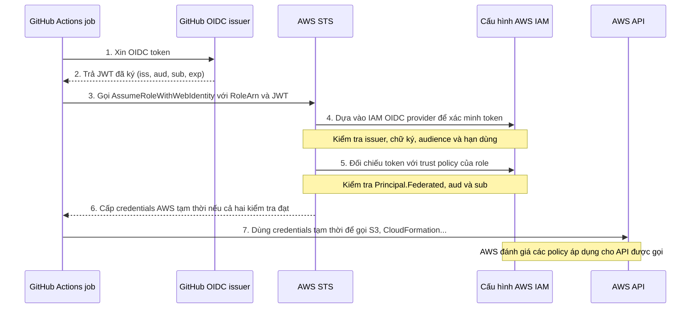

# Plan 01: Đọc lại cách dự án mẫu cho GitHub Actions đăng nhập AWS bằng OIDC

Plan này chỉ đọc, không tạo gì. Đọc xong, bạn giải thích được vì sao workflow của dự án mẫu gọi được AWS mà trong GitHub không có access key nào, và biết repo đó đã được thiết lập theo thứ tự nào. Thời lượng khoảng 60–90 phút.

**Dự án mẫu** là repo `3-tiers-app-infrastructure`:

- trên máy: `D:\code\terraform-3-tiers-app\3-tiers-app-infrastructure`, nhánh `development`;
- trên GitHub: <https://github.com/hieupham259/3-tiers-app-infrastructure>.

Mọi số dòng trong plan này lấy ở commit [`4de50f9`](https://github.com/hieupham259/3-tiers-app-infrastructure/tree/4de50f9b3d740454eb72c6f957fe9bda0380cdee) của nhánh `development`, đối chiếu ngày **17/11/2026**. Lúc đó bản trên máy và `origin/development` trùng nhau. Nhánh `master` và `production` không có thư mục `notes/` đầy đủ, nên đọc ở `development`.

## Mục lục

- [1. OIDC trong một phút](#1-oidc-trong-một-phút)
  - [Từ GitHub OIDC token đến quyền gọi AWS API](#từ-github-oidc-token-đến-quyền-gọi-aws-api)
- [2. Ba lớp, lớp sau dùng quyền do lớp trước tạo](#2-ba-lớp-lớp-sau-dùng-quyền-do-lớp-trước-tạo)
  - [Vì sao cả hai dự án tách role bootstrap, plan và apply?](#vì-sao-cả-hai-dự-án-tách-role-bootstrap-plan-và-apply)
- [3. Lộ trình đọc](#3-lộ-trình-đọc)
- [4. Repo mẫu đã được thiết lập theo thứ tự nào](#4-repo-mẫu-đã-được-thiết-lập-theo-thứ-tự-nào)
- [5. Ghi chú trong `notes/` lệch code ở đâu](#5-ghi-chú-trong-notes-lệch-code-ở-đâu)
- [6. Ba điều dự án mới buộc phải làm khác](#6-ba-điều-dự-án-mới-buộc-phải-làm-khác)
- [7. Câu hỏi tự kiểm](#7-câu-hỏi-tự-kiểm)
- [8. Xong plan này khi nào](#8-xong-plan-này-khi-nào)

## 1. OIDC trong một phút

Khi job xin OIDC token, GitHub cấp cho job một tờ giấy giới thiệu có chữ ký, ghi rõ job thuộc repo nào, chạy trên nhánh hay môi trường nào. AWS được dặn trước: "tin giấy do GitHub ký, và chỉ giấy ghi đúng nội dung X mới được vào role Y". Job đưa giấy cho AWS và nhận credentials tạm thời có thời hạn riêng.

Điều hay bị hiểu nhầm: **không phải cứ là workflow của repo thì vào được role**. AWS so từng chữ trong dòng `sub` của tờ giấy với điều kiện ghi trong role. Dòng `sub` đổi theo ngữ cảnh chạy:

| Job chạy thế nào | `sub` có dạng |
|---|---|
| Job khai `environment: X` | `repo:<owner>/<repo>:environment:X` |
| Sự kiện `pull_request`, job không khai environment | `repo:<owner>/<repo>:pull_request` |
| Chạy trên một nhánh, job không khai environment | `repo:<owner>/<repo>:ref:refs/heads/<nhánh>` |

Job đã khai `environment` thì `sub` luôn theo dạng environment, không còn mang tên nhánh. Chi tiết này là nguyên nhân của lần sửa trust policy ngày 15/05/2026 ở dự án mẫu, xem [chặng 4](#chặng-4-các-role-dùng-hằng-ngày).

Thuật ngữ: tờ giấy là **JWT** (OIDC token), nơi dặn AWS là **IAM OIDC provider**, điều kiện ghi trong role là **trust policy**, lệnh đổi giấy lấy khoá là `sts:AssumeRoleWithWebIdentity`.

### Từ GitHub OIDC token đến quyền gọi AWS API



Sau khi nhận JWT do GitHub ký, job gửi token và ARN của role muốn sử dụng cho AWS STS qua `AssumeRoleWithWebIdentity`. Trong workflow, action `aws-actions/configure-aws-credentials` thực hiện lời gọi này.

- **Bước 4 — AWS STS kiểm tra token.** Resource `AWS::IAM::OIDCProvider` tạo bản ghi IAM trong AWS account. `Url` xác định issuer được đăng ký và `ClientIdList` liệt kê các audience được chấp nhận. AWS dùng khoá công khai do GitHub công bố để kiểm tra chữ ký JWT. **GitHub phát hành token, job gửi token, STS xác minh token.** Bản ghi IAM cung cấp cấu hình để AWS xác minh. Nếu thiếu provider phù hợp trong account, STS từ chối yêu cầu.
- **Bước 5 — AWS STS kiểm tra job có được assume role hay không.** Trong `AssumeRolePolicyDocument` của `AWS::IAM::Role`, `Principal.Federated` trỏ tới ARN của OIDC provider. `Condition` kiểm tra các claim như `aud` và `sub`. Một token hợp lệ vẫn có thể bị từ chối nếu `sub` của job không khớp điều kiện role.
- **Bước 6–7 — STS cấp credentials tạm thời, rồi AWS kiểm quyền trên từng API.** Job dùng credentials để ký các request tiếp theo. Khi job gọi API như `s3:GetObject`, AWS đánh giá quyền áp dụng cho request, bao gồm các permission policy gắn với role qua `Policies` hoặc `ManagedPolicyArns`.

`AssumeRolePolicyDocument` trả lời **job nào được nhận role**. Permission policy trả lời **phiên dùng role đó được gọi API nào, trên tài nguyên nào**. [IAM OIDC provider](https://docs.aws.amazon.com/IAM/latest/UserGuide/id_roles_providers_create_oidc.html) · [AWS STS API](https://docs.aws.amazon.com/STS/latest/APIReference/API_AssumeRoleWithWebIdentity.html) · [Cách AWS đánh giá policy](https://docs.aws.amazon.com/IAM/latest/UserGuide/reference_policies_evaluation-logic.html)

## 2. Ba lớp, lớp sau dùng quyền do lớp trước tạo

| Lớp | Ai chạy | Tạo ra | File |
|---|---|---|---|
| 0. Trust anchor | người, upload một lần qua Console | OIDC provider của account, role `gha-bootstrap` | `bootstrap/01-trust-anchor.yaml` |
| 1. Bootstrap | workflow `bootstrap.yaml`, dùng role `gha-bootstrap` | bucket S3 + KMS cho Terraform state; role `gha-infra-plan`, `gha-infra-apply`, hai role deploy của repo backend và frontend | `bootstrap/02-tfstate-backend.yaml`, `bootstrap/03-github-oidc-roles.yaml` |
| 2. Hạ tầng | workflow `terraform-*.yaml`, dùng role `gha-infra-plan` và `gha-infra-apply` | VPC, RDS, ECS, ALB... | `envs/`, `modules/` |

Thiếu lớp 0 thì workflow bootstrap không có role nào để vào. Thiếu lớp 1 thì workflow Terraform không có role và không có chỗ lưu state. Đây là lý do dự án mẫu có đúng một bước làm tay.

### Vì sao cả hai dự án tách role bootstrap, plan và apply?

Cả dự án mẫu `3-tiers-app-infrastructure` và dự án mới `aws-eks-mysql-platform` đều tách ba role phục vụ CI/CD hạ tầng. Trong mỗi dự án, ba role dùng cùng GitHub OIDC provider của AWS account và yêu cầu `aud` là `sts.amazonaws.com`. Trust policy của từng role xác định job nào được assume role đó.

| Vai trò | Stack tạo role | Dự án mẫu | Dự án mới | Quyền và công việc chung |
|---|---|---|---|---|
| Bootstrap | `01-trust-anchor` | `gha-bootstrap` | `aws-eks-mysql-platform-gha-bootstrap` | `AdministratorAccess`. Job dùng Environment `bootstrap` để triển khai stack 02 và 03. |
| Plan | `03-github-oidc-roles` | `gha-infra-plan` | `aws-eks-mysql-platform-gha-plan` | `ReadOnlyAccess` và quyền riêng cho backend Terraform state. Job dùng role này để chạy `terraform plan` trên pull request hoặc kiểm tra drift. |
| Apply | `03-github-oidc-roles` | `gha-infra-apply` | `aws-eks-mysql-platform-gha-apply` | `AdministratorAccess`. Workflow dùng role này để áp dụng thay đổi Terraform lên hạ tầng. |

Stack 03 của dự án mẫu còn tạo hai role deploy cho repo ứng dụng, `gha-backend-deploy` và `gha-frontend-deploy`. Bảng trên tập trung vào ba role phục vụ hạ tầng. [Stack 01 của dự án mẫu](https://github.com/hieupham259/3-tiers-app-infrastructure/blob/4de50f9b3d740454eb72c6f957fe9bda0380cdee/bootstrap/01-trust-anchor.yaml) · [Stack 03 của dự án mẫu](https://github.com/hieupham259/3-tiers-app-infrastructure/blob/4de50f9b3d740454eb72c6f957fe9bda0380cdee/bootstrap/03-github-oidc-roles.yaml) · [Stack 01 của dự án mới](../bootstrap/01-trust-anchor.yaml) · [Stack 03 của dự án mới](../bootstrap/03-github-oidc-roles.yaml)

**Tách stack theo thứ tự triển khai.** Người vận hành deploy stack 01 trước để GitHub Actions có role đăng nhập AWS lần đầu. Workflow bootstrap dùng role đó để deploy stack 02, lấy ARN của bucket S3 và KMS key rồi truyền vào stack 03 khi tạo các role Terraform.

**Tách role theo công việc.** Role plan chỉ cần quyền đọc hạ tầng và quyền cần thiết trên backend state. Tách role này giữ quyền quản trị ngoài các job kiểm tra PR và drift. Role bootstrap và role apply hiện cùng có `AdministratorAccess`, nhưng dùng cho hai giai đoạn khác nhau. Tách chúng cho phép đặt điều kiện assume riêng và điều chỉnh quyền từng role độc lập.

**Dự án mới siết role apply và quyền state.** Role plan và apply của dự án mẫu cùng chấp nhận `repo:<org>/<repo>:*`. Dự án mới giữ điều kiện đó cho role plan, và siết role apply: job phải khai một Environment, tức `sub` có dạng `:environment:*`, và tên Environment phải nằm trong danh sách lấy từ biến repo `DEPLOY_ENVIRONMENTS`. Với backend state, policy của role plan trong dự án mẫu cho phép ghi cả file `terraform.tfstate`. Dự án mới cấp quyền đọc trên file state và cấp thêm quyền tạo/xoá trên file khoá `.tflock`.

## 3. Lộ trình đọc

Đọc theo đúng thứ tự dưới. Mỗi chặng ghi: đọc đâu, đọc để trả lời câu gì, và điều phải thấy.

### Chặng 1: Khái niệm (bỏ qua nếu còn nhớ)

- [`notes/OIDC-GUIDE.md` mục 1–7, dòng 9–238](https://github.com/hieupham259/3-tiers-app-infrastructure/blob/4de50f9b3d740454eb72c6f957fe9bda0380cdee/notes/OIDC-GUIDE.md?plain=1#L9-L238): access key dài hạn có vấn đề gì, JWT gồm những gì, AWS kiểm tra chữ ký ra sao.
- Điều phải thấy: bảng claim ở mục 5. Hai claim quyết định là `aud` (gửi cho ai) và `sub` (job là ai).

### Chặng 2: Trust anchor, bước làm tay duy nhất

- [`bootstrap/01-trust-anchor.yaml`, dòng 16–52](https://github.com/hieupham259/3-tiers-app-infrastructure/blob/4de50f9b3d740454eb72c6f957fe9bda0380cdee/bootstrap/01-trust-anchor.yaml#L16-L52).
- Câu hỏi: file này tạo mấy thứ, và ai được vào role `gha-bootstrap`?
- Điều phải thấy:
  - Dòng 17–24: `AWS::IAM::OIDCProvider` với URL `https://token.actions.githubusercontent.com` và `ClientIdList: sts.amazonaws.com`. Không có `ThumbprintList`: thuộc tính này là tuỳ chọn, IAM tự lấy khi thiếu.
  - Dòng 33–34: role mang `AdministratorAccess`.
  - Dòng 42–47: hai điều kiện. `aud` phải là `sts.amazonaws.com`, và `sub` phải là `repo:<org>/<repo>:environment:bootstrap`. Tức chỉ job khai `environment: bootstrap` của đúng repo này mới vào được.
  - Dòng 19–20 và 28–29: `DeletionPolicy: Retain`. Xoá stack thì provider và role vẫn ở lại.
- Đọc kèm lời giải thích ở [`notes/OIDC-GUIDE.md` mục 9, dòng 473–531](https://github.com/hieupham259/3-tiers-app-infrastructure/blob/4de50f9b3d740454eb72c6f957fe9bda0380cdee/notes/OIDC-GUIDE.md?plain=1#L473-L531).

### Chặng 3: Workflow bootstrap, lần đầu GitHub vào AWS

- [`.github/workflows/bootstrap.yaml`](https://github.com/hieupham259/3-tiers-app-infrastructure/blob/4de50f9b3d740454eb72c6f957fe9bda0380cdee/.github/workflows/bootstrap.yaml), cả file 85 dòng.
- Câu hỏi: ba dòng nào làm nên việc "đăng nhập không cần key"?
- Điều phải thấy:
  - Dòng 12–14: `permissions: id-token: write`. Thiếu dòng này job không xin được JWT.
  - Dòng 19: `environment: bootstrap`. Dòng này vừa bắt người duyệt, vừa làm `sub` mang đuôi `:environment:bootstrap`, khớp với điều kiện ở chặng 2.
  - Dòng 36–40: `aws-actions/configure-aws-credentials@v4` với `role-to-assume`. Không có `aws-access-key-id` hay `secrets.*` nào.
  - Dòng 22: account ID lấy từ biến repo `vars.DEV_ACCOUNT_ID` / `vars.PROD_ACCOUNT_ID`, không ghi cứng.
  - Dòng 45–80: deploy stack 02, đọc output của nó, rồi truyền vào stack 03. Thứ tự này là bắt buộc: role ở stack 03 cần ARN của bucket và KMS key.

### Chặng 4: Các role dùng hằng ngày

- [`bootstrap/03-github-oidc-roles.yaml`, dòng 31–92](https://github.com/hieupham259/3-tiers-app-infrastructure/blob/4de50f9b3d740454eb72c6f957fe9bda0380cdee/bootstrap/03-github-oidc-roles.yaml#L31-L92).
- Câu hỏi: role plan và role apply khác nhau ở quyền và ở điều kiện vào thế nào?
- Điều phải thấy:
  - `gha-infra-plan` (dòng 33–69): `ReadOnlyAccess`, cộng quyền đọc/ghi state và dùng KMS key (dòng 54–69).
  - `gha-infra-apply` (dòng 72–92): `AdministratorAccess`.
  - **Cả hai role dùng chung điều kiện `sub` là `repo:<org>/<repo>:*`** (dòng 51–53 và 90–92). Dấu `*` nghĩa là mọi nhánh, mọi pull request, mọi environment của repo đều vào được, kể cả role admin.
  - Tham số `AllowedBranch` (dòng 20–23) được khai và được workflow truyền vào, nhưng không còn chỗ nào trong template dùng tới.
- Vì sao ra nông nỗi này: bản đầu tiên giới hạn role apply theo nhánh, `...:ref:refs/heads/${AllowedBranch}`. Nhưng job apply khai `environment`, nên `sub` thật là `...:environment:development`, không khớp, và AWS từ chối. Commit `ec629be` ngày 15/05/2026 sửa bằng cách nới thành `:*`. Xem lịch sử bằng:

  ```bash
  git -C "D:/code/terraform-3-tiers-app/3-tiers-app-infrastructure" log --format='%h %ad %s' --date=short -- bootstrap/03-github-oidc-roles.yaml
  git -C "D:/code/terraform-3-tiers-app/3-tiers-app-infrastructure" show ec629be -- bootstrap/03-github-oidc-roles.yaml
  ```

  Cách sửa đúng là đổi điều kiện sang dạng `...:environment:<tên>`, không phải nới thành `*`. Dự án mới làm theo hướng đó cho role apply: `sub` phải có dạng `:environment:*`, và tên Environment phải nằm trong một danh sách.

### Chặng 5: Workflow Terraform dùng role nào

- [`terraform-plan.yaml` dòng 18–21 và 54–57](https://github.com/hieupham259/3-tiers-app-infrastructure/blob/4de50f9b3d740454eb72c6f957fe9bda0380cdee/.github/workflows/terraform-plan.yaml#L18-L57): quyền `id-token: write`, vào `gha-infra-plan`.
- [`terraform-apply.yaml` dòng 11–13, 30–33 và 46–49](https://github.com/hieupham259/3-tiers-app-infrastructure/blob/4de50f9b3d740454eb72c6f957fe9bda0380cdee/.github/workflows/terraform-apply.yaml#L11-L49): `environment` suy ra từ tên nhánh, vào `gha-infra-apply`.
- [`terraform-drift.yaml` dòng 14–19 và 35–38](https://github.com/hieupham259/3-tiers-app-infrastructure/blob/4de50f9b3d740454eb72c6f957fe9bda0380cdee/.github/workflows/terraform-drift.yaml#L14-L38): chạy theo lịch, vào `gha-infra-plan`.
- Điều phải thấy: không workflow nào có access key. Workflow nào cũng có đủ hai thứ: `id-token: write` và `role-to-assume`.

### Chặng 6: Toàn cảnh theo thời gian

- [`notes/CICD-CHAIN-OF-TRUST.md`](https://github.com/hieupham259/3-tiers-app-infrastructure/blob/4de50f9b3d740454eb72c6f957fe9bda0380cdee/notes/CICD-CHAIN-OF-TRUST.md?plain=1): sơ đồ ba lớp, bảng "workflow nào dùng role nào", sơ đồ tuần tự từ `git push` tới lúc tài nguyên được tạo.
- [`notes/OIDC-GUIDE.md` mục 17, dòng 870–1200](https://github.com/hieupham259/3-tiers-app-infrastructure/blob/4de50f9b3d740454eb72c6f957fe9bda0380cdee/notes/OIDC-GUIDE.md?plain=1#L870-L1200): đi từng pha từ lúc job chạy tới từng lời gọi API, và bảng "lỗi nào hỏng ở pha nào".
- **Đọc hai file này với [bảng lệch ở mục 5](#5-ghi-chú-trong-notes-lệch-code-ở-đâu) mở bên cạnh.** Chúng viết trước khi code đổi, nên vài chỗ không còn đúng.

### Chặng 7: Cách kiểm tra và siết lại

- [`notes/OIDC-GUIDE.md` mục 8, dòng 239–470](https://github.com/hieupham259/3-tiers-app-infrastructure/blob/4de50f9b3d740454eb72c6f957fe9bda0380cdee/notes/OIDC-GUIDE.md?plain=1#L239-L470): bước 4 (dấu hiệu đăng nhập thành công), bước 5 (tra CloudTrail), bước 6 (siết dần).
- Điều phải thấy: bước 6 tự khuyên thu hẹp `sub` và dùng dạng `:environment:<tên>` cho role gắn với Environment. Code hiện tại của dự án mẫu chưa làm theo lời khuyên của chính nó.

## 4. Repo mẫu đã được thiết lập theo thứ tự nào

Bảng dưới xếp theo phụ thuộc: việc sau cần việc trước. Nó ghép từ hai nguồn: [`notes/plans/2026-05-12-initial-deploy/README.md`](https://github.com/hieupham259/3-tiers-app-infrastructure/blob/4de50f9b3d740454eb72c6f957fe9bda0380cdee/notes/plans/2026-05-12-initial-deploy/README.md?plain=1), mục "Phase A", ghi những việc đã làm thật; và [`notes/SETUP-GUIDE.md`](https://github.com/hieupham259/3-tiers-app-infrastructure/blob/4de50f9b3d740454eb72c6f957fe9bda0380cdee/notes/SETUP-GUIDE.md?plain=1), là hướng dẫn viết trước khi làm, nên dòng nào chỉ dẫn tới SETUP-GUIDE thì cần mở GitHub để xác nhận.

| # | Việc | Làm ở đâu | Đọc ở |
|---|---|---|---|
| 1 | Viết ba template bootstrap và workflow `bootstrap.yaml`, đưa lên nhánh mặc định | code | SETUP-GUIDE Phase 3–4, dòng 228–709 |
| 2 | Tạo Environment `bootstrap`: có người duyệt, chỉ cho nhánh mặc định | GitHub → Settings → Environments | SETUP-GUIDE Phase 2.1, dòng 196–204 |
| 3 | Upload `01-trust-anchor.yaml` bằng Console, tên stack `trust-anchor` | AWS Console → CloudFormation | SETUP-GUIDE Phase 5, dòng 711–777 |
| 4 | Đặt biến repo `DEV_ACCOUNT_ID`, `PROD_ACCOUNT_ID` | Settings → Secrets and variables → Actions → Variables | initial-deploy, A.1 |
| 5 | Chạy workflow Bootstrap, duyệt, ra stack `tfstate-backend` và `github-oidc-roles` | GitHub → Actions | SETUP-GUIDE Phase 7, dòng 793–821 |
| 6 | Tạo Environment `development`, `production`: người duyệt là chủ repo, nhánh deploy trùng tên environment | Settings → Environments | initial-deploy, A.2 |
| 7 | Siết cho repo public: PR từ fork phải được duyệt mới chạy workflow; token mặc định chỉ đọc | Settings → Actions → General | initial-deploy, A.3 |
| 8 | Tạo hai nhánh sống lâu `development`, `production` từ `master` | git | initial-deploy, A.4 |
| 9 | Từ đây mới tới Terraform: PR vào `development`, plan, merge, duyệt, apply | GitHub | plan 02 |

Hình "Deployments" của repo mẫu khớp với bảng này: lần deploy gần nhất của `bootstrap` là 6 tháng trước, của `development` là 5 tháng trước. Không có `production`, vì phần đưa lên production (Phase C của initial-deploy) chưa làm.

Hai điều repo không tự nói ra, phải mở GitHub mới biết. Ghi lại để dùng ở plan 03:

- Settings → Environments → từng environment: ai là reviewer, nhánh nào được deploy, ô "Allow administrators to bypass configured protection rules" bật hay tắt.
- Settings → Secrets and variables → Actions: tab Variables có những biến nào; Environment secrets có `RDS_MASTER_PASSWORD` không.

## 5. Ghi chú trong `notes/` lệch code ở đâu

Ba file `OIDC-GUIDE.md`, `CICD-CHAIN-OF-TRUST.md`, `SETUP-GUIDE.md` viết lúc thiết kế. Code đã đổi sau đó. Khi hai bên khác nhau, **code đúng**.

| Chủ đề | Ghi chú viết | Code hiện tại |
|---|---|---|
| Điều kiện vào `gha-infra-apply` | `StringEquals` với `...:ref:refs/heads/<nhánh>` (OIDC-GUIDE mục 10 "Layer 4", CICD-CHAIN-OF-TRUST dòng 223–234) | `StringLike` với `repo:<org>/<repo>:*` (`03-github-oidc-roles.yaml` dòng 88–92) |
| "Bốn tầng bảo vệ" (OIDC-GUIDE mục 12) | tầng 4 là IAM chỉ nhận đúng nhánh | tầng 4 không còn: IAM nhận mọi ngữ cảnh của repo. Còn lại là các tầng phía GitHub |
| Region | `ap-southeast-1` | `us-east-1` |
| Account ID | ghi cứng trong workflow, kiểu `111111111111` | biến repo `vars.DEV_ACCOUNT_ID`, `vars.PROD_ACCOUNT_ID` |
| Số account | hai account riêng cho development và production | một account cho cả hai: hai file `envs/*/backend.tf` trỏ cùng một bucket |
| `ThumbprintList` của provider | có hai thumbprint | không khai |
| Nhánh chứa bootstrap | `main` | `master` là nhánh mặc định |
| Người duyệt của `development` | 0, tự deploy (SETUP-GUIDE Phase 2.2) | có người duyệt là chủ repo (initial-deploy, A.2) |
| Biến account | biến của từng Environment | biến cấp repo |
| `.github/CODEOWNERS` | có (README, SETUP-GUIDE 1.3) | không có trong repo |

## 6. Ba điều dự án mới buộc phải làm khác

Chép nguyên bộ bootstrap của dự án mẫu sang repo mới sẽ hỏng ở ba chỗ. Plan 03 xử lý cả ba.

**1. Repo tạo từ 15/07/2026 có `sub` dạng mới.** GitHub gắn thêm ID vào tên owner và tên repo:

```text
repo mẫu (tạo 05/2026):   repo:<owner>/<repo>:environment:bootstrap
repo mới (tạo sau 15/07): repo:<owner>@<owner_id>/<repo>@<repo_id>:environment:bootstrap
```

Trust policy viết theo dạng cũ sẽ không khớp, và AWS chỉ báo chung chung `Not authorized to perform sts:AssumeRoleWithWebIdentity`. Vì vậy dự án mới lấy hai ID của repo trước, ghép thành tiền tố của `sub` (plan 03, bước 2), rồi mới viết điều kiện. Lần đăng nhập thật đầu tiên, ở bước 5, cho biết tiền tố có đúng không.

**2. Account đã có sẵn những thứ trùng tên.** Nếu dùng cùng account với dự án mẫu:

- mỗi account chỉ có một OIDC provider cho GitHub, và stack `trust-anchor` của dự án mẫu đã tạo nó;
- tên role `gha-bootstrap`, `gha-infra-plan`, `gha-infra-apply`, alias KMS `alias/tfstate`, tên stack `trust-anchor`, `tfstate-backend`, `github-oidc-roles` và các `Export` của stack đều đã có chủ.

Dự án mới dùng lại provider có sẵn, và đặt tiền tố tên dự án cho mọi thứ còn lại.

**3. Điều kiện `:*` trên role admin.** Dự án mới giới hạn hai role admin theo Environment: role bootstrap chỉ nhận `:environment:bootstrap`; role apply chỉ nhận job chạy trong một Environment có tên nằm trong biến repo `DEPLOY_ENVIRONMENTS`, lúc đầu là `development,production`. Role plan chỉ đọc nên giữ `:*` như mẫu. Plan 03 chỉ chạy thử trường hợp được vào; nó không có bước thử các trường hợp phải bị từ chối.

## 7. Câu hỏi tự kiểm

Che phần trả lời, tự trả lời rồi so.

1. **Trong GitHub của repo mẫu có lưu access key AWS không?** Không. Chỉ có hai biến chứa account ID, và một environment secret là mật khẩu RDS, không phải khoá AWS.
2. **Thứ gì trong workflow cho phép job xin JWT?** `permissions: id-token: write`.
3. **Vì sao job bootstrap vào được `gha-bootstrap` còn job khác thì không?** Vì job đó khai `environment: bootstrap`, nên `sub` mang đuôi `:environment:bootstrap`, đúng với điều kiện của role.
4. **Một workflow trên nhánh `feature/x` của repo mẫu, có `id-token: write`, tự gọi `role-to-assume: .../gha-infra-apply`. AWS có cho không?** Có, vì điều kiện là `repo:<org>/<repo>:*`. Thứ duy nhất chặn là người viết workflow đó phải có quyền push lên repo.
5. **Vậy Environment `development` có người duyệt thì bảo vệ được gì?** Nó chặn job nào khai `environment: development`. Nó không chặn job không khai environment mà vẫn xin role apply. Muốn chặn loại đó, phải chặn ở IAM.
6. **Xoá stack `trust-anchor` thì OIDC provider có mất không?** Không, vì `DeletionPolicy: Retain`.
7. **Vì sao stack 02 phải deploy trước stack 03?** Role plan ở stack 03 cần ARN của bucket state và KMS key, là output của stack 02.
8. **Khoá tạm sống bao lâu?** Một giờ theo mặc định; `MaxSessionDuration` của role là trần.

## 8. Xong plan này khi nào

- Trả lời được 8 câu ở mục 7 mà không mở file.
- Vẽ lại được bảng ba lớp ở mục 2: lớp nào do ai chạy, bằng role nào.
- Đã ghi lại cấu hình Environments và Variables thật của repo mẫu (cuối mục 4).
- Nói được ba điều dự án mới phải làm khác và lý do.

Sau đó sang [plan 02](02-doc-lai-thiet-ke-cicd-cua-du-an-mau.md).

## Nguồn

- GitHub Docs, [OpenID Connect reference](https://docs.github.com/en/actions/reference/security/oidc): các dạng `sub`, dạng có ID cho repo tạo sau 15/07/2026.
- GitHub Changelog 23/04/2026, [Immutable subject claims for GitHub Actions OIDC tokens](https://github.blog/changelog/2026-04-23-immutable-subject-claims-for-github-actions-oidc-tokens/).
- AWS IAM, [Create a role for OpenID Connect federation](https://docs.aws.amazon.com/IAM/latest/UserGuide/id_roles_create_for-idp_oidc.html): IAM bắt buộc trust policy của role dùng provider GitHub phải có điều kiện trên `sub`.
- [`aws-actions/configure-aws-credentials`](https://github.com/aws-actions/configure-aws-credentials): mục "Immutable subject claims" và lỗi khi trust policy còn theo dạng cũ.
