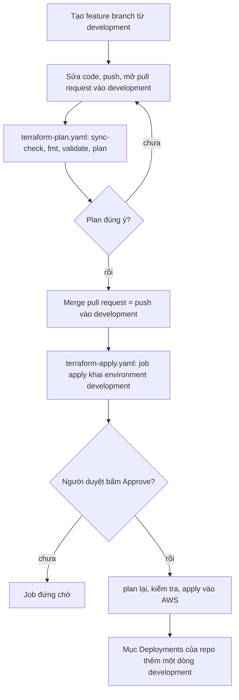

# Plan 02: Đọc lại thiết kế CI/CD của dự án mẫu

Plan này chỉ đọc, không tạo gì. Đọc xong, bạn nói được một thay đổi Terraform ở dự án mẫu đi từ feature branch tới AWS qua những cửa nào, cửa nào nằm trong code, cửa nào nằm trong phần Settings của GitHub. Thời lượng khoảng 60–90 phút. Làm sau [plan 01](01-doc-lai-oidc-cua-du-an-mau.md).

Dự án mẫu, cách dẫn dòng và ngày đối chiếu giống plan 01: repo [`3-tiers-app-infrastructure`](https://github.com/hieupham259/3-tiers-app-infrastructure), nhánh `development`, commit [`4de50f9`](https://github.com/hieupham259/3-tiers-app-infrastructure/tree/4de50f9b3d740454eb72c6f957fe9bda0380cdee), ngày **17/11/2026**.

## Mục lục

- [1. Thiết kế trong một câu](#1-thiết-kế-trong-một-câu)
- [2. Sáu workflow](#2-sáu-workflow)
- [3. Nhánh nào ra môi trường nào](#3-nhánh-nào-ra-môi-trường-nào)
- [4. Lộ trình đọc code](#4-lộ-trình-đọc-code)
- [5. Thiết lập trên GitHub: nhánh và Environments](#5-thiết-lập-trên-github-nhánh-và-environments)
- [6. Một thay đổi đi từ feature branch tới AWS](#6-một-thay-đổi-đi-từ-feature-branch-tới-aws)
- [7. Những điểm yếu nhìn thấy trong code](#7-những-điểm-yếu-nhìn-thấy-trong-code)
- [8. Dự án mới giữ gì, đổi gì](#8-dự-án-mới-giữ-gì-đổi-gì)
- [9. Câu hỏi tự kiểm](#9-câu-hỏi-tự-kiểm)

## 1. Thiết kế trong một câu

Tên nhánh quyết định mọi thứ: merge vào nhánh `development` là deploy lên môi trường development, merge vào nhánh `production` là deploy lên production. Không có Terraform workspace, không có nút "promote"; đưa code từ môi trường này sang môi trường kia là mở pull request giữa hai nhánh.

Điều hay bị hiểu nhầm: **người duyệt pull request và người duyệt deploy là hai cửa khác nhau**. Cửa thứ nhất nằm ở pull request, trước khi merge. Cửa thứ hai là GitHub Environment, chặn job `apply` sau khi đã merge. Code chỉ khai tên Environment; ai duyệt và nhánh nào được dùng thì đặt trong Settings, không nằm trong repo.

## 2. Sáu workflow

| Workflow | Chạy khi | Environment | Role AWS | Làm gì |
|---|---|---|---|---|
| `bootstrap.yaml` | bấm tay, chọn account | `bootstrap` | `gha-bootstrap` | deploy hai stack CloudFormation 02 và 03 |
| `terraform-plan.yaml` | pull request vào `development` hoặc `production`, có đổi `envs/**`, `modules/**`, `scripts/**` | không | `gha-infra-plan` | kiểm tra hai thư mục env giống nhau, `fmt`, `validate`, `plan`, chặn xoá tài nguyên có dữ liệu, ghi plan vào pull request |
| `terraform-apply.yaml` | push vào `development` hoặc `production`, có đổi `envs/**`, `modules/**` | trùng tên nhánh | `gha-infra-apply` | `plan` lại, chặn xoá tài nguyên có dữ liệu, `apply`, ghi mật khẩu RDS vào Secrets Manager |
| `terraform-drift.yaml` | 01:00 hằng ngày, hoặc bấm tay | không | `gha-infra-plan` | `plan -detailed-exitcode` cho từng môi trường |
| `cfn-drift-detect.yaml` | 01:00 Chủ nhật, hoặc bấm tay | không | `gha-infra-plan` | dò lệch của ba stack bootstrap |
| `terraform-destroy.yaml` | bấm tay, phải gõ `destroy` | theo lựa chọn | `gha-infra-apply` | xoá riêng RDS instance bằng `-target` |

## 3. Nhánh nào ra môi trường nào

| Nhánh | Environment | Biến account | Thư mục Terraform | Key của state |
|---|---|---|---|---|
| `development` | `development` | `vars.DEV_ACCOUNT_ID` | `envs/development` | `3-tiers-app/development/terraform.tfstate` |
| `production` | `production` | `vars.PROD_ACCOUNT_ID` | `envs/production` | `3-tiers-app/production/terraform.tfstate` |
| `master` | không deploy | | | |

- `master` là nhánh mặc định. Workflow chạy theo lịch và workflow bấm tay lấy file từ nhánh này.
- Trên thực tế hai biến account mang cùng một giá trị, và hai `backend.tf` trỏ cùng một bucket. Hai môi trường chỉ tách nhau bằng key của state và tiền tố tên tài nguyên.

Phép ánh xạ được viết lặp lại ở bốn chỗ, mỗi workflow một kiểu:

- plan: theo nhánh đích của pull request, `github.base_ref` ([dòng 35–36](https://github.com/hieupham259/3-tiers-app-infrastructure/blob/4de50f9b3d740454eb72c6f957fe9bda0380cdee/.github/workflows/terraform-plan.yaml#L35-L36));
- apply: theo nhánh vừa nhận push, `github.ref` ([dòng 30–33](https://github.com/hieupham259/3-tiers-app-infrastructure/blob/4de50f9b3d740454eb72c6f957fe9bda0380cdee/.github/workflows/terraform-apply.yaml#L30-L33));
- drift: ma trận ghi tay ([dòng 17–19](https://github.com/hieupham259/3-tiers-app-infrastructure/blob/4de50f9b3d740454eb72c6f957fe9bda0380cdee/.github/workflows/terraform-drift.yaml#L17-L19));
- destroy: theo lựa chọn lúc bấm ([dòng 62–65](https://github.com/hieupham259/3-tiers-app-infrastructure/blob/4de50f9b3d740454eb72c6f957fe9bda0380cdee/.github/workflows/terraform-destroy.yaml#L62-L65)).

## 4. Lộ trình đọc code

### Chặng 1: Ý định của thiết kế

- [`README.md` dòng 183–206](https://github.com/hieupham259/3-tiers-app-infrastructure/blob/4de50f9b3d740454eb72c6f957fe9bda0380cdee/README.md?plain=1#L183-L206): "Workflow summary", "Branch model", "Quality gates".
- Điều phải thấy: hai nhánh sống lâu, code giống hệt nhau sau mỗi lần đưa lên; khác biệt chỉ nằm ở ba file của từng thư mục env.

### Chặng 2: Vì sao hai môi trường chạy cùng một code

- [`envs/development/backend.tf`](https://github.com/hieupham259/3-tiers-app-infrastructure/blob/4de50f9b3d740454eb72c6f957fe9bda0380cdee/envs/development/backend.tf): bucket, key, `kms_key_id = "alias/tfstate"`, `use_lockfile = true`.
- [`envs/development/main.tf`](https://github.com/hieupham259/3-tiers-app-infrastructure/blob/4de50f9b3d740454eb72c6f957fe9bda0380cdee/envs/development/main.tf): chỉ có một `module "stack"` trỏ tới `../_shared`.
- [`envs/_shared/main.tf`](https://github.com/hieupham259/3-tiers-app-infrastructure/blob/4de50f9b3d740454eb72c6f957fe9bda0380cdee/envs/_shared/main.tf): chín module của hạ tầng.
- [`scripts/verify-envs-in-sync.sh`](https://github.com/hieupham259/3-tiers-app-infrastructure/blob/4de50f9b3d740454eb72c6f957fe9bda0380cdee/scripts/verify-envs-in-sync.sh): dòng 9 và 13, so `main.tf` và `variables.tf` của hai thư mục env.
- Điều phải thấy: thư mục env là nơi chạy `terraform init`; code thật nằm ở `_shared`. Tên bucket trong `backend.tf` chứa account ID và được commit thẳng vào repo.

### Chặng 3: Pull request sinh ra plan

- [`terraform-plan.yaml`](https://github.com/hieupham259/3-tiers-app-infrastructure/blob/4de50f9b3d740454eb72c6f957fe9bda0380cdee/.github/workflows/terraform-plan.yaml), 102 dòng.
- Điều phải thấy:
  - Dòng 9–16: chỉ chạy với pull request vào hai nhánh môi trường, và chỉ khi đổi các đường dẫn đã liệt kê.
  - Dòng 24–29: job `sync-check` chạy trước, job `plan` chờ nó (`needs`, dòng 32).
  - Dòng 43: mật khẩu RDS trong plan là giá trị giả; mật khẩu thật không bao giờ tới tay một pull request.
  - Dòng 59–72: `fmt -check`, `init`, `validate`, `plan`. Bước plan có `continue-on-error`, để bước ghi comment vẫn chạy khi plan lỗi.
  - Dòng 79–86: gọi action `check-state-preservation`.
  - Dòng 88–98: ghi plan vào pull request.
  - Dòng 100–102: plan lỗi thì cho job đỏ.

### Chặng 4: Merge sinh ra apply

- [`terraform-apply.yaml`](https://github.com/hieupham259/3-tiers-app-infrastructure/blob/4de50f9b3d740454eb72c6f957fe9bda0380cdee/.github/workflows/terraform-apply.yaml), 91 dòng.
- Điều phải thấy:
  - Dòng 3–9: chạy khi push vào hai nhánh môi trường. Merge một pull request chính là một lần push.
  - Dòng 15–17: `concurrency` theo nhánh, `cancel-in-progress: false`. Hai lần apply cùng môi trường xếp hàng, không huỷ nhau.
  - Dòng 30: `environment` suy ra từ tên nhánh. Đây là dòng làm job dừng lại chờ người duyệt, nếu Environment đó có đặt người duyệt.
  - Dòng 51–70: `init`, `plan -out`, kiểm tra, `apply tfplan`. Plan và apply nằm trong **cùng một job**, sau cửa duyệt.
  - Dòng 72–91: phần riêng của RDS, ghi mật khẩu từ GitHub Environment secret vào Secrets Manager sau khi apply.

### Chặng 5: Chốt chặn xoá tài nguyên có dữ liệu

- [`check-state-preservation/action.yaml`](https://github.com/hieupham259/3-tiers-app-infrastructure/blob/4de50f9b3d740454eb72c6f957fe9bda0380cdee/.github/actions/check-state-preservation/action.yaml) và [`check.sh`](https://github.com/hieupham259/3-tiers-app-infrastructure/blob/4de50f9b3d740454eb72c6f957fe9bda0380cdee/.github/actions/check-state-preservation/check.sh).
- Điều phải thấy trong `check.sh`:
  - Dòng 36–49: danh sách loại tài nguyên bị coi là có dữ liệu, gồm cả `aws_s3_bucket`, `aws_eks_cluster`, `aws_eks_node_group`.
  - Dòng 87–90: đọc file JSON của plan, tìm thay đổi có hành động `delete` (xoá hẳn, hoặc thay thế).
  - Dòng 107: muốn cho qua phải ghi `acknowledged-destroy:<địa chỉ resource>` vào commit message, tiêu đề hoặc nhãn của pull request.
- Đây là thứ dự án mới sẽ cần khi có bucket backup và cluster EKS. Nó chưa nằm trong bốn plan đầu.

### Chặng 6: Dò lệch

- [`terraform-drift.yaml`](https://github.com/hieupham259/3-tiers-app-infrastructure/blob/4de50f9b3d740454eb72c6f957fe9bda0380cdee/.github/workflows/terraform-drift.yaml), 45 dòng: lịch ở dòng 5, mỗi môi trường checkout đúng nhánh của nó (dòng 27–29), `plan -detailed-exitcode` (dòng 43–45). Mã thoát 2 nghĩa là có khác biệt, và làm job đỏ.
- [`cfn-drift-detect.yaml`](https://github.com/hieupham259/3-tiers-app-infrastructure/blob/4de50f9b3d740454eb72c6f957fe9bda0380cdee/.github/workflows/cfn-drift-detect.yaml), 58 dòng: cùng ý, nhưng cho ba stack CloudFormation.
- Điều phải thấy: "lệch" ở đây là mọi khác biệt giữa code trên nhánh và AWS. Ai đó sửa tay trên AWS là lệch. Code đã merge nhưng chưa apply cũng bị báo là lệch.

### Chặng 7: Xoá

- [`terraform-destroy.yaml`](https://github.com/hieupham259/3-tiers-app-infrastructure/blob/4de50f9b3d740454eb72c6f957fe9bda0380cdee/.github/workflows/terraform-destroy.yaml), 105 dòng. Phần chú thích đầu file (dòng 3–17) kể ba lớp an toàn: chỉ bấm tay, phải gõ `destroy`, và Environment.
- Điều phải thấy: dòng 105 chỉ xoá đúng một resource, RDS instance. Dự án mẫu không có workflow nào dọn cả môi trường.

### Chặng 8: Người ta đã dùng quy trình này ra sao

- [`notes/plans/2026-05-15-phased-deploy-development/README.md`](https://github.com/hieupham259/3-tiers-app-infrastructure/blob/4de50f9b3d740454eb72c6f957fe9bda0380cdee/notes/plans/2026-05-15-phased-deploy-development/README.md?plain=1), mục "Deployment model" và bảng "Sprints": mỗi đợt một feature branch, một pull request vào `development`, plan, merge, duyệt, apply.
- `git -C "D:/code/terraform-3-tiers-app/3-tiers-app-infrastructure" branch -r` cho thấy các feature branch thật: `feature/phased-deploy-s01-full-networking`, `...-s02-ecr-alb-ecs`, `...-s03-rds-iam`, `...-s04-full-stack`.
- Điều phải thấy: hạ tầng được đưa lên từng lớp, mỗi lớp một pull request. Dự án mới đi cùng nhịp đó: networking, rồi S3, rồi EKS.

## 5. Thiết lập trên GitHub: nhánh và Environments

Phần này không nằm trong code. Bảng dưới gom ba nguồn: tài liệu thiết kế (`SETUP-GUIDE.md`), nhật ký việc đã làm (initial-deploy, mục "Phase A"), và những gì code đòi hỏi.

| Thiết lập | Tài liệu thiết kế viết | Thực tế đã làm, hoặc code đòi hỏi | Mở ở đâu để xem |
|---|---|---|---|
| Nhánh sống lâu | `development`, `production`; nhánh mặc định là `development` | có thêm `master` làm nhánh mặc định, không deploy | Settings → General → Default branch |
| Environment `bootstrap` | 1 người duyệt, chỉ nhánh chứa bootstrap | code khai `environment: bootstrap` | Settings → Environments |
| Environment `development` | không người duyệt, tự deploy | người duyệt là chủ repo; nhánh deploy trùng tên environment (A.2) | Settings → Environments |
| Environment `production` | 1 người duyệt, chờ 5 phút | người duyệt là chủ repo; nhánh deploy trùng tên (A.2); chưa deploy lần nào | Settings → Environments |
| Biến | `AWS_ACCOUNT_ID` theo từng Environment | hai biến cấp repo `DEV_ACCOUNT_ID`, `PROD_ACCOUNT_ID` (A.1) | Settings → Secrets and variables → Actions → Variables |
| Secret | không nhắc | `RDS_MASTER_PASSWORD`, secret của Environment | Settings → Environments → từng environment |
| Bảo vệ nhánh | bắt buộc pull request và các check `sync-check`, `plan (development)`, `plan (production)`, `tflint`, `tfsec` | trong code chỉ có hai job tên `sync-check` và `plan`; không có job `tflint` hay `tfsec`. Nhật ký không ghi đã bật bảo vệ nhánh hay chưa | Settings → Branches, hoặc Settings → Rules |
| Workflow của fork | không nhắc | pull request từ người ngoài phải được duyệt mới chạy; token mặc định chỉ đọc (A.3) | Settings → Actions → General |
| Admin vượt cửa duyệt | không nhắc | còn bỏ ngỏ (D.6) | Settings → Environments → `production` |

Việc cần làm ở chặng này: mở từng trang Settings ở cột cuối của repo mẫu, ghi lại giá trị thật. Plan 03 sẽ đặt các giá trị tương ứng cho repo mới, và bạn sẽ muốn biết mình đang giữ hay đang đổi so với repo mẫu.

Ba điều về Environment mà giao diện không nói rõ:

- **Chỉ repo public mới có người duyệt nếu bạn dùng gói Free, Pro hoặc Team.** Repo private cần gói Enterprise mới đặt được người duyệt. Repo mẫu là public.
- **Workflow gọi tên một Environment chưa tồn tại thì GitHub tự tạo nó, không có luật bảo vệ nào.** Gõ nhầm tên là có ngay một environment "trắng".
- **Ô "Prevent self-review"** cấm người khởi chạy tự duyệt. Repo một người mà bật ô này thì không ai duyệt được.

## 6. Một thay đổi đi từ feature branch tới AWS

Đưa lên production là lặp lại đúng luồng này, với pull request từ `development` vào `production`.

Hình "Deployments 28" của repo mẫu đếm số lần một job khai `environment` đã chạy. Mỗi lần apply hoặc bootstrap là một dòng. Chỉ thấy `development` và `bootstrap` vì nhánh `production` chưa từng nhận một lần apply nào.

## 7. Những điểm yếu nhìn thấy trong code

Đọc tới đây bạn sẽ gặp các chỗ dưới. Cột cuối ghi dự án mới đổi hay giữ. Năm workflow của dự án mới viết theo đúng khung của dự án mẫu, nên các điểm yếu nằm trong khung đó được giữ nguyên và ghi thành giới hạn ở plan 03.

| # | Chỗ trong dự án mẫu | Hệ quả | Dự án mới |
|---|---|---|---|
| 1 | Role apply nhận `repo:<org>/<repo>:*` (plan 01, chặng 4) | cửa duyệt của Environment không được IAM chống lưng: job không khai environment vẫn xin được role admin | **đổi:** role apply chỉ nhận job chạy trong một Environment có tên nằm trong biến repo `DEPLOY_ENVIRONMENTS`. Role plan giữ `:*` như mẫu |
| 2 | Plan và apply chung một job, sau cửa duyệt (`terraform-apply.yaml` dòng 30 và 51–70) | người duyệt bấm Approve khi chưa thấy plan của lần chạy này, chỉ có plan cũ trong pull request | **giữ như mẫu:** một job, duyệt rồi mới plan và apply. Người duyệt đọc plan trong comment của pull request |
| 3 | Bước comment nhét thẳng output của plan vào mã JavaScript (`terraform-plan.yaml` dòng 92) | plan có dấu `` ` `` hoặc `${` làm hỏng đoạn script | **giữ như mẫu** |
| 4 | Workflow plan có bộ lọc `paths` (dòng 12–16) | nếu đặt job `plan` làm check bắt buộc, pull request không chạm các đường dẫn đó sẽ treo mãi vì check không bao giờ chạy | **giữ như mẫu:** giữ bộ lọc `paths`, và không đặt job `plan` làm check bắt buộc |
| 5 | Drift dùng `github.event.repository.name` làm biến Terraform (`terraform-drift.yaml` dòng 22) | **cần kiểm chứng:** với sự kiện `schedule`, giá trị này có thể rỗng. Khi đó tag `Repository` của mọi tài nguyên bị coi là đổi và lần chạy theo lịch báo lệch giả. Nhật ký initial-deploy (D.1) ghi các workflow drift chưa từng được xác nhận chạy thật | **đổi:** không truyền biến này; tên dự án nằm trong `terraform.tfvars` |
| 6 | Drift đỏ thì chỉ đỏ, không báo cho ai | lệch nằm đó tới khi có người mở tab Actions | **giữ như mẫu** |
| 7 | `terraform-destroy.yaml` chỉ xoá RDS | không có đường dọn cả môi trường qua CI | **đổi:** workflow destroy xoá cả môi trường, vẫn theo khung một job của mẫu, không có bước xem trước |
| 8 | Tham số `AllowedBranch` còn được truyền nhưng không dùng (`bootstrap.yaml` dòng 77) | người đọc tưởng role đang bị giới hạn theo nhánh | **đổi:** bỏ tham số |
| 9 | README và SETUP-GUIDE nhắc `CODEOWNERS`, `tflint`, `tfsec`; workflow không chạy chúng | tài liệu hứa nhiều hơn cái đang có | **đổi:** README của dự án mới chỉ ghi cái đã có |
| 10 | `verify-envs-in-sync.sh` chỉ so hai file | hai thư mục env vẫn có thể lệch ở file khác | **giữ như mẫu:** script chép nguyên, so `main.tf` và `variables.tf` |

## 8. Dự án mới giữ gì, đổi gì

**Giữ nguyên:**

- Một nhánh sống lâu cho mỗi môi trường; tên nhánh, tên Environment và tên thư mục `envs/<tên>` trùng nhau.
- Ba template bootstrap và một bước làm tay duy nhất.
- Hai role: plan chỉ đọc, apply được ghi.
- Pull request sinh plan; merge sinh apply; apply đi qua Environment có người duyệt.
- `envs/<tên>` chỉ chứa phần khác nhau, code chung ở `envs/_shared`.
- State trên S3 có KMS và khoá bằng lock file.
- Khung của năm workflow `bootstrap`, `terraform-plan`, `terraform-apply`, `terraform-drift`, `terraform-destroy`: cùng job, cùng thứ tự bước. Mỗi job vào AWS có thêm một bước kiểm biến account.
- Hai thư mục `envs/development` và `envs/production`, và script `verify-envs-in-sync.sh`.

**Đổi:** các dòng 1, 5, 7, 8 và 9 ở mục 7, cộng ba điều ở mục 6 của plan 01 (dạng `sub` mới, đụng tên trong account, điều kiện `:*`). Ngoài ra, dự án mới bỏ kiểu biểu thức "`production` hay không" ở mục 3: tên nhánh được dùng thẳng làm tên Environment, tên thư mục `envs/<tên>` và phần đầu của biến `<TÊN>_ACCOUNT_ID`. Hai biến `DEVELOPMENT_ACCOUNT_ID` và `PRODUCTION_ACCOUNT_ID` thay cho `DEV_ACCOUNT_ID` và `PROD_ACCOUNT_ID`.

**Giữ dù là điểm yếu:** các dòng 2, 3, 4, 6 và 10 ở mục 7, vì chúng nằm trong khung workflow của dự án mẫu.

**Chưa mang sang:** `check-state-preservation`, `cfn-drift-detect.yaml`, `tflint`. Chúng thuộc các lớp sau, khi dự án có tài nguyên giữ dữ liệu.

## 9. Câu hỏi tự kiểm

1. **Merge một pull request vào `development` thì workflow nào chạy, vì sao?** `terraform-apply.yaml`, vì merge tạo một lần push vào `development`, miễn là có đổi `envs/**` hoặc `modules/**`.
2. **Job apply biết mình deploy vào môi trường nào bằng cách nào?** Suy từ `github.ref`: nhánh `production` thì `production`, còn lại là `development`.
3. **Ai quyết định job apply phải chờ duyệt?** Phần Settings của Environment trên GitHub. Trong code chỉ có một dòng khai tên Environment.
4. **Người duyệt ở cửa Environment của dự án mẫu đã thấy plan của lần chạy đó chưa?** Chưa. Plan chạy sau khi duyệt, trong cùng job.
5. **Workflow drift chạy theo lịch thì dùng file workflow của nhánh nào, và so code của nhánh nào?** File workflow của nhánh mặc định `master`; code thì mỗi môi trường checkout nhánh của nó.
6. **Vì sao code vừa merge nhưng chưa được duyệt apply lại bị drift báo lệch?** Vì drift so code trên nhánh với AWS, mà AWS chưa có thay đổi đó.
7. **Nếu đổi repo mẫu thành private trên gói Free thì mất gì?** Mất Environment có người duyệt, tức mất cửa duyệt trước khi apply.
8. **Hình Deployments không có `production` nói lên điều gì?** Chưa có job nào khai `environment: production` từng chạy, tức production chưa được deploy.

Trả lời được 8 câu, và đã ghi lại thiết lập thật ở mục 5, thì sang [plan 03](03-trien-khai-oidc-roi-cicd.md).

## Nguồn

- GitHub Docs, [Managing environments for deployment](https://docs.github.com/en/actions/how-tos/deploy/configure-and-manage-deployments/manage-environments): environment tự được tạo khi workflow gọi tên chưa có; "Prevent self-review"; tối đa 6 người duyệt.
- GitHub Docs, [Deployments and environments](https://docs.github.com/en/actions/reference/workflows-and-actions/deployments-and-environments): người duyệt và thời gian chờ chỉ có ở repo public với gói Free, Pro, Team.
- GitHub Docs, [Events that trigger workflows](https://docs.github.com/en/actions/reference/workflows-and-actions/events-that-trigger-workflows): `schedule` chỉ chạy trên nhánh mặc định; ở repo public, workflow theo lịch tự tắt sau 60 ngày repo không có hoạt động.
